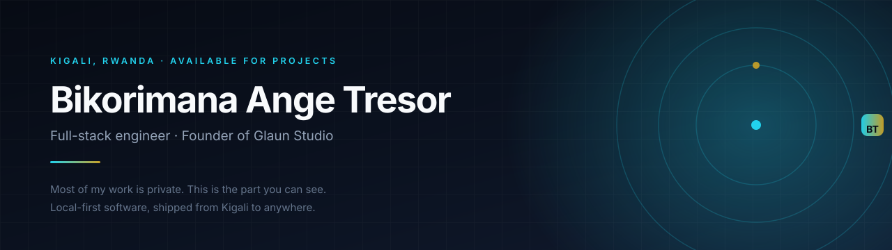
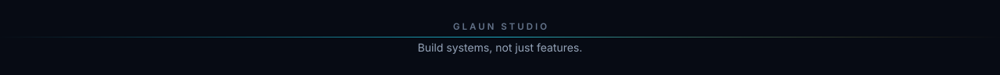

  

  
  
  

  
  
  

---

## The short version

I'm a full-stack engineer in **Kigali, Rwanda**, and the founder of **Glaun Studio**.

I build software that keeps working when the network doesn't — offline-first mobile apps, local model inference, and the permission layers that make an AI assistant safe to point at real files. I write the whole thing myself: schema, API, and the interface people actually touch.

> **Build systems, not just features.**

## If this profile looks quiet, that's deliberate

Most of what I build lives in **private repositories** — client platforms, mobile products, AI systems. What you can see here is a fraction of the work, and I would rather show one thing that runs than ten that only screenshot well.

That leaves two ways to see the rest:

1. **Follow the build** on [Instagram](#follow-the-build) — progress, screens and lessons, posted as they happen.
2. **Ask me directly.** I'm happy to walk through private work on a call.

## Featured

<table>
<tr>
<td width="72%" valign="top">

**[ClaireAI](https://github.com/tres9lo/claireai)** — a personal assistant that runs entirely on your machine. Local model inference, an append-only audit trail, and file and browser tools that cannot act without explicit approval.

*Status: early build — the agent loop and permission layer work; the desktop shell is next.*

</td>
<td width="28%" valign="top" align="right">

`Python` `SQLite` `Ollama` `MIT`

</td>
</tr>
</table>

## Older public work

| Project | What it is | Stack |
| --- | --- | --- |
| [E-State](https://github.com/tres9lo/e-state-realty) | Real-estate site with live property search, lightbox and validated forms | HTML · CSS · JS |
| [Visit Musanze](https://github.com/tres9lo/visit-musanze) | Tourism site for Musanze District, gateway to Volcanoes National Park | HTML · CSS · JS |
| [Student Records System](https://github.com/tres9lo/student-records-system) | School administration: students, courses, grades and attendance | Laravel · PHP |

## Currently

- **ClaireAI** — making a local assistant trustworthy enough to hand real folders to.
- **Glaun Studio** — product and platform work for clients across East Africa.
- **Open to new projects** — especially local-first tools, mobile products and AI systems that need a careful permissions story.

## How I build

| Principle | What it means in practice |
| --- | --- |
| **Local-first by default** | If a feature works without a network, it should. Cloud is a choice, not a prerequisite. |
| **The boundary is code, not a prompt** | Validation, allow-lists and audit trails live in the runtime — never in a system message. |
| **Ship the smallest honest version** | Every README states what works and what does not. No screenshots of features that were never built. |

## Toolbox

  
  
  
  
  

  
  
  
  
  

  
  
  
  
  

## Work with me

**Ready for business.** If you need a product built end to end — web, mobile or AI — I would like to hear about it.

<table>
<tr>
<td valign="top" width="50%">

**Phone / WhatsApp**
[+250 794 623 125](https://wa.me/250794623125)
</td>
<td valign="top" width="50%">

**Email**
[bikotreslo.99@gmail.com](mailto:bikotreslo.99@gmail.com)
</td>
</tr>
<tr>
<td valign="top">

**Website**
[tresor-dev.netlify.app](https://tresor-dev.netlify.app)
</td>
<td valign="top">

**LinkedIn**
[tresor-dev-biko](https://www.linkedin.com/in/tresor-dev-biko-4671b6361)
</td>
</tr>
</table>

## Follow the build

The interesting parts happen between commits, and most of them are not on GitHub.

  
  

